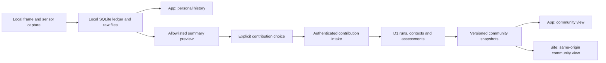

# Personal and community benchmark aggregation

Status: local prototype, November 8, 2026 UTC. No intake routes, background
uploads, database migrations or production UI are enabled by this work.

The requested sharing model is private local history, opt-in anonymous
community contributions, and a separate opt-in for named public profiles.

## Implemented foundation

- `@grimoire/social-types/benchmarks` exports strict submission schemas,
  internal assessment records, and pure personal/community aggregation.
- `cli/benchmark/preview.ts` renders a local interactive preview and writes
  the same aggregate JSON shapes intended for the app and site.
- `../vpkmerge/tools/deadlock-benchmark/analysis/export-aggregation-pilot.py`
  adapts the existing fixed eight-attempt comparison, checks registered
  configuration/capture/treatment evidence, and exports only allowed fields.
- `cli/benchmark/aggregate.test.ts` tests duplicate handling, contribution
  weighting, independent-launch counts, privacy suppression, context separation,
  validity exclusions, malformed metrics and owner isolation.

The pilot has two personal groups: Sqooky 3/4 completed and OptiLock 4/4
completed. Median average FPS is 297.9 and 298.7 respectively. There are no
publishable community groups. This is one machine's exploratory reconstruction,
not representative community performance. The seven retained fight windows
use approximate timing. Earlier pilots/crashes remain in the source ledger;
this adapter deliberately covers only the declared final experiment.

## Storage and ownership



Reuse the Social Worker's infrastructure with a separate benchmark D1 binding
and retention policy. This prevents benchmark volume from competing directly
with profile data. D1 offers SQLite semantics and Worker access
([Cloudflare D1](https://developers.cloudflare.com/d1/)). Keep per-frame and
sensor streams in the local evidence directory. Summary rows are small enough
for relational querying; optional shared raw evidence can use object storage
later, with a separate user action and retention policy.

Do not use sampled operational analytics as the benchmark source of truth.
Analytics Engine can sample its data
([sampling documentation](https://developers.cloudflare.com/analytics/analytics-engine/sampling/));
benchmark submissions need exact deduplication, ownership, retraction and
reproducible assessments. This recommendation is an architectural choice,
not a claim that D1 has been provisioned or load-tested here.

`benchmark-schema.sql` is an executable SQLite design fixture, outside the
production migrations directory. Promote it through an additive migration
only when intake, deletion and assessment rules are implemented together.

## Identity, consent and deletion

- Personal history works offline without an account or contribution ID.
- Enabling contribution registers a random pseudonymous contributor credential,
  independent of Steam. The main process keeps the bearer secret in secure
  storage. The backend assigns the contributor ID; clients cannot choose it.
- A random local machine ID distinguishes systems without serials, MAC addresses,
  hostnames or a hardware fingerprint. It is internal and absent from public
  aggregate responses. Hardware classes are not unique machine identities.
- The public sees aggregate statistics, not contributor identities. The service
  still receives an IP address and holds pseudonymous records. Do not market
  this as untraceable anonymity. Specify request-log retention before launch.
- Preview the summary before contributing. Start with a user-triggered action
  for a complete experiment, including failures. A persistent auto-contribute
  preference, if added, defaults off and has a distinct consent version.
- Turning contribution off prevents future submissions. A separate withdrawal
  action deletes existing owned contributions and invalidates/rebuilds affected
  snapshots. Account or profile deletion must also remove named links and
  follow the withdrawal choice disclosed to that user.
- Named profiles require a second explicit choice and Social authentication.
  Never automatically connect anonymous contributions to an existing Steam
  session. Link only specifically selected results, with an unlink action.
- Recovery of a lost anonymous credential needs a documented policy before
  release. Do not promise account-based deletion of unlinked anonymous data.

No new network calls are implemented in this prototype. Before enabling them,
update the app privacy guide and the website privacy page with destinations,
fields, trigger, retention, withdrawal and logging behavior.

## Documented context

The local ledger remains the detailed evidence record. Community contributions
use an allowlist rather than uploading `configuration.json` wholesale.

| Context | Local evidence | Shared summary |
| --- | --- | --- |
| Hardware | CPU, enumerated GPUs/drivers, logical cores, reported usable RAM | CPU/GPU class, selected driver when verified, usable RAM bucket |
| OS | OS, kernel/release, architecture, graphics environment | OS/release, compatibility layer, graphics API |
| Game and scenario | Game/map/scenario/runtime files and hashes | Build, workload and runtime fingerprints |
| Launch | Requested flags, runtime/launcher provenance, logs | Canonical sanitized launch-policy hash, null if incomplete |
| Configuration | Video/config snapshots and runtime checks | Preset/version, settings hash, resolution, render scale, cap, upscaler, VSync |
| Capture | Raw frames, sensors, collector config and version | Frame semantics, backend/version, scope, metric version, pass metrics |
| Time and outcome | UTC times, monotonic observations, phases, failures | Recorded UTC, experiment/run IDs, completed/failed/cancelled |

Requested settings are not effective settings. The current ledger has gaps in
complete launch options and renderer readback. The pilot explicitly sets
`launch_policy_sha256: null`, `effective_settings_verified: false`, graphics API
to null, and driver to null because the selected capture's driver label is
empty. An enumerated driver for another device does not prove which GPU rendered.
RAM is a coarse 8 GiB bucket of OS-reported usable memory, not verified DIMM
capacity. CPU governor alone is not a complete power/thermal state measurement.

The next collector revision should record the effective executable, normalized
argument vector, selected Steam launch options and an allowlist of relevant
environment variables per platform. Keep requested and observed values separate.
Replace user-specific paths with stable roles before hashing a shared launch
policy; remove credentials, arbitrary environment values and free-text commands.
Include frame generation, refresh/display mode, addons, overclock/power limits
and a verified settings readback in a registered protocol or context revision
before enabling accepted submissions. Unsupported context revisions fail closed.

## Aggregation rules

1. Preserve raw run identity and metric version. Deduplicate on contributor and
   client run ID. An identical retry is a no-op; a conflicting retry is an error.
   A reanalysis is a new assessment revision, never a silent replacement.
2. Group only identical context and assessment-policy revisions. CPU/GPU,
   OS/kernel/driver, game build, workload, protocol, capture version/semantics,
   resolution, render scale, cap, preset/settings and cache/power policy are all
   group dimensions. Do not pool Linux/MangoHud and Windows/PresentMon by default.
3. Summarize measured windows within each independent launch. Repeated passes
   are not independent trials. Whole-capture diagnostics stay separate from
   estimated or aligned fight windows.
4. Personal distributions use independent-launch summaries. Community statistics
   take the median across launches for each machine, across machines for each
   contributor, then across contributors. One prolific contributor does not
   receive extra statistical weight. Contributor IDs are not proven humans:
   anonymous credential re-registration remains an abuse risk to mitigate.
5. Retain completed, failed and cancelled counts. Failed attempts have no FPS,
   not zero FPS. Performance summaries are conditional on successful capture.
   Counts describe submitted attempts, not all attempts the person ever made.
6. Display medians and observed quartiles/ranges with the aggregation unit.
   A median of per-run 1% lows is labelled that way; it is not a 1% low from a
   concatenated frame stream. Quartiles are descriptive, not confidence bounds.
7. Community publication currently requires accepted aligned-fight records,
   effective settings verification, known driver/API/power policy and a complete
   launch-policy hash. Acceptance comes from the service's protocol policy,
   never a submitted `comparison_eligible` flag.
8. Suppress the entire community cell below five contributors and ten completed
   launches, including its hardware and counts. These are provisional product
   thresholds, not proof of statistical significance or a privacy guarantee.

The prototype supports exact groups only. A broader view must visibly identify
the dimension being compared and cannot silently drop incompatible dimensions.
Preset uplift should use matched experiments on the same machine and protocol,
then aggregate paired changes. Comparing two unrelated GPU populations is not
evidence that one preset is faster. Sparse groups should say insufficient data.

To reduce small-cell disclosure, public queries should select precomputed fixed
periods (for example UTC calendar months) and an approved context catalog. Do not
offer arbitrary time slicing or a full-resolution global total alongside
suppressed cells: subtraction can reveal excluded contributions. Apply review
to revisions, overlapping periods and optional named profiles as well.

## API and UI integration to implement next

These are proposed routes, not existing endpoints:

| Consumer | Interface | Purpose |
| --- | --- | --- |
| App main process | `POST /v1/benchmarks/contributors` | Explicit opt-in credential registration |
| App main process | `POST /v1/benchmarks/runs` | Bounded batch, validated allowlist, idempotent submission |
| App main process | `DELETE /v1/benchmarks/contributions` | Authenticated withdrawal and snapshot invalidation |
| App and site server | `GET /v1/benchmarks/aggregates` | Fixed-period public summaries and policy metadata |
| App local IPC | `benchmark-history`, `benchmark-detail`, `benchmark-aggregate` | Paginated private ledger views and config diffs |
| App local IPC | `benchmark-contribution-preview` | Exact proposed payload, no upload |
| Optional Social profile | Separate authenticated link/unlink routes | Named publication, never implicit |

The service must enforce body limits, contributor quotas, context catalog
validation, schema/metric consistency and withdrawal ownership. Recompute all
derivable summaries server-side. Submitted FPS can still be fabricated: local
hashes and successful parsing do not authenticate game execution. Label results
as contributed measurements with their assessment policy, not certified scores.

App: reuse existing main-process SQLite/IPC and secure credential patterns;
renderer gets typed summaries, never tokens. Keep experiment filters and raw
evidence links in personal history. Add contribution preview and withdrawal
before an automatic contribution preference. Experimental features default off.

Site: add `/benchmarks` with same-origin data from a site Worker route backed by
the aggregate API. Visitors need no account to browse. Do not embed private
history, individual runs or credentials in build output. The current offline
preview demonstrates the contract; it is not a deployed Astro route.

Both surfaces should show hardware/OS, scope and acceptance next to metrics;
date/preset/hardware filters; average FPS and 1% low charts; p99 frame times;
attempt/completion counts; contributor/machine counts; and clear empty states.
Sort groups deterministically by preset by default. Offer metric sorting only
within a compatible selected group. Never manufacture a winner when ranges
overlap or only one machine contributed.

## Reproduce the local pilot

From `vpkmerge`, export to a new path (existing outputs are not overwritten):

```sh
python tools/deadlock-benchmark/analysis/export-aggregation-pilot.py \
  /mnt/storage/vpkmerge-benchmarks/config-comparison-20261108 \
  /tmp/grimoire-benchmark-pilot/records.json
```

From `grimoire-social`:

```sh
./node_modules/.bin/tsx --test cli/benchmark/aggregate.test.ts
./node_modules/.bin/tsc --noEmit
./node_modules/.bin/tsc --noEmit -p cli/tsconfig.json
./node_modules/.bin/tsx cli/benchmark/preview.ts \
  /tmp/grimoire-benchmark-pilot/records.json /tmp/grimoire-benchmark-pilot/preview
```

Open the resulting `index.html`. The view/metric selectors use bundled local
data with no network requests. Shared protocol and UI integration remain the
next implementation slice; this prototype does not change any game config.
